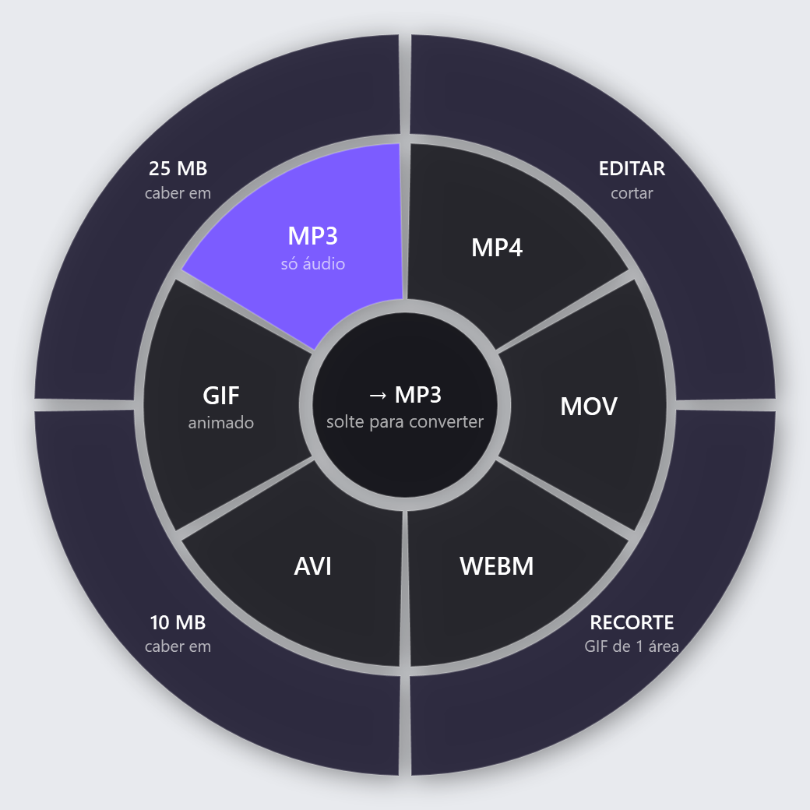

# 🌀 Gira

**Converta qualquer arquivo sem abrir programa nenhum.**
Segure **Shift**, arraste o arquivo no Explorer e solte no formato que você quer.

---

## ✨ Como funciona

1. No Explorer (ou na Área de Trabalho), **segure Shift e comece a arrastar** um ou mais arquivos.
2. Uma **roda** aparece em volta do cursor.
   - **Anel de dentro:** formatos para converter (MP4, PDF, JPG…).
   - **Anel de fora:** ferramentas (comprimir, cortar, juntar, caber em X MB…).
3. **Solte** em cima da opção. Um cartão no canto da tela mostra o progresso, com o botão **Mostrar** quando termina.

O arquivo original **nunca é alterado**. A cópia nova é salva ao lado dele (`foto.png` → `foto.jpg`).

Também dá para usar:
- **Clique direito → "Converter com Gira"** (no Windows 11, em *Mostrar mais opções*);
- **Clique no ícone do Gira** perto do relógio para abrir a roda no centro da tela e arrastar arquivos até ela.

> 🔒 **Tudo acontece no seu computador.** Nenhum arquivo é enviado para a internet.

---

## 🔄 O que ele converte

| Você arrasta | Vira |
|---|---|
| 🖼️ **Imagem** (jpg, png, webp, gif, bmp, tiff, avif, ico) | PNG, JPG, WEBP, GIF, BMP, TIFF, ICO |
| 🎵 **Áudio** (mp3, m4a, wav, flac, ogg, opus, aac, wma…) | MP3, M4A, WAV, FLAC, OGG, OPUS |
| 🎬 **Vídeo** (mp4, mov, mkv, avi, webm, wmv…) | MP4, MOV, MKV, WEBM, AVI, **GIF**, MP3 (só o áudio) |
| 📄 **Word** (docx, doc, odt, rtf) | PDF, DOCX |
| 📕 **PDF** | Word (DOCX), mantendo o layout |
| 📊 **Excel** (xlsx, xls, ods) | CSV (um por aba), XLSX |
| 📑 **CSV** | Excel (XLSX) |
| 📁 **Pasta** | ZIP, RAR (com WinRAR), 7Z (com 7-Zip) |
| 📦 **Compactado** (zip, rar, 7z…) | Extrair para uma pasta |

O CSV sai no padrão brasileiro (`;` e vírgula decimal) e abre direto no Excel.

---

## 🧰 Ferramentas (anel de fora)

| Para | Ferramentas |
|---|---|
| 🖼️ **Imagens** | Reduzir para **50%**, **1920 px** ou **1080 px** · **Caber em 1 MB / 10 MB** · **Juntar fotos em 1 PDF** |
| 🎬 **Vídeos** | **Editar** · **Recorte** (GIF de uma área) · **Caber em 10 MB / 25 MB** (ótimo para WhatsApp e e-mail) |
| 📕 **PDFs** | **Juntar** vários em um · **Dividir** (uma página por arquivo) · **Comprimir** · **Caber em 10 / 25 MB** |
| 📄 **Word e PowerPoint** | **Comprimir** (reduz as fotos e fontes embutidas) · **Caber em 10 / 25 MB** |
| 📊 **Excel** | **Comprimir** |
| 🗂️ **Vários arquivos** | **ZIP** com tudo |

### ✂️ Editor de vídeo
Escolha **EDITAR** na roda para abrir um editor simples:
- **Cortar:** cortar antes ou depois de um ponto (**I** / **O**), dividir (**S**), apagar trechos (**Delete**), desfazer (**Ctrl+Z**).
- **Ajustes:** velocidade de 0,5× a 2×, tirar o som, girar o vídeo.
- **Salvar** (**Ctrl+S**): em MP4 normal ou cabendo em 10 / 25 MB.

### 🎞️ GIF de alta qualidade
- O GIF sai na **resolução do vídeo** (até 1280 px de largura), com paleta de cores tirada do próprio vídeo, para o texto ficar nítido.
- **Bordas pretas** são cortadas sozinhas.
- **RECORTE** abre um quadro do vídeo para você **desenhar a área** que vai para o GIF. Serve, por exemplo, para pegar só a tela remota do AnyDesk, sem barras nem bordas de janela.

---

## ⚙️ Configurações

Clique direito no ícone do Gira → **Configurações…**

- **Onde salvar:** ao lado do original ou sempre numa pasta fixa.
- **Qualidade:** Alta, Normal ou Menor (arquivos menores).
- **GIF:** largura máxima, quadros por segundo e corte automático das bordas pretas.
- **Lixeira:** mandar o original para a Lixeira depois de converter.
- **Integração:** mostrar "Converter com Gira" no clique direito e iniciar junto com o Windows.

A roda segue o **tema claro ou escuro** do Windows.

---

## 📥 Instalação

1. Baixe o **[GiraSetup.exe](https://github.com/Arthur-Rabello/gira-releases/releases/latest/download/GiraSetup.exe)** e abra.
2. O instalador mostra **só o que falta** no seu computador e baixa sozinho:

   | Componente | Para quê |
   |---|---|
   | FFmpeg | imagens, áudio, vídeo e GIF |
   | LibreOffice | Word ↔ PDF |
   | Python + pdf2docx | PDF → Word, juntar, dividir e comprimir PDF |
   | 7-Zip *(opcional)* | criar 7Z e extrair RAR/7Z |

3. Pronto: o Gira fica no ícone perto do relógio e já inicia com o Windows.

Não precisa ser administrador. Só o LibreOffice e o 7-Zip pedem permissão uma vez.

> Se o Windows mostrar "O Windows protegeu o computador", clique em **Mais informações → Executar assim mesmo**. O aviso aparece porque o instalador não tem assinatura paga.

## ⬆️ Atualizações

O Gira avisa sozinho quando sai versão nova. Para instalar, clique direito no ícone → **⬆ Atualizar para a versão X**. Ele baixa, instala e abre de novo, sem perder suas configurações.

Para checar na hora, use **Procurar atualizações** no mesmo menu.

---

## ❓ Dúvidas rápidas

**A roda não aparece.**
Segure Shift **antes** de começar a arrastar, e arraste a partir do Explorer ou da Área de Trabalho. Veja também se "Ativado" está marcado no menu do ícone.

**"Converter com Gira" não aparece no clique direito.**
No Windows 11, ele fica em *Mostrar mais opções*. Se ainda não aparecer, reinicie o Explorer pelo Gerenciador de Tarefas.

**Diz que falta FFmpeg ou LibreOffice.**
Rode o instalador de novo e marque o que faltar.

---

Sugestões ou problemas? **Me chama no Discord** 💬

